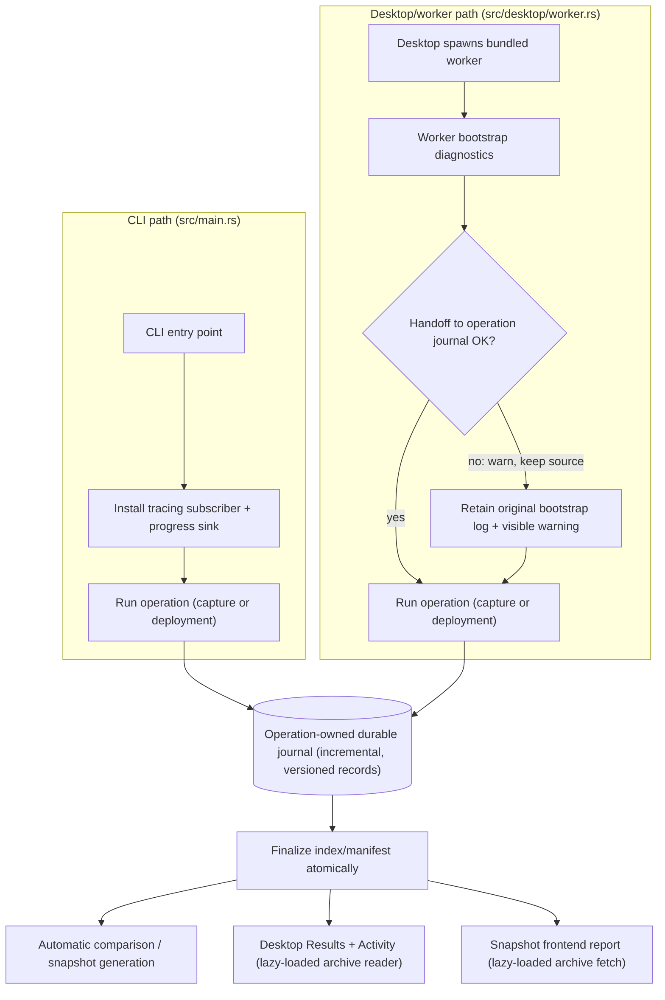

<!-- istari:plan-review generated file — safe to delete -->
<!-- istari:plan-review owner:0b66699e22aad8678758c61eed6abb2d7b50b4662c942041beee20cc459c70c2 -->
# Logging Revamp Plan

Status: Proposed, with product decisions confirmed on 2026-10-01 and an initial
task breakdown drafted this round; ready for reviewer re-check before
implementation kickoff.

## Context and Motivation

Capture and deployment failures in Regressify are hard to diagnose today without
reproducing the run. `scenario_log!` always writes to stderr, but the desktop's
retained live history is bounded (2 MiB, 4,096 entries, 16 KiB per retained
message) and is explicitly not the full-log source of truth; deployment
orchestration also writes phases and heartbeat messages directly to stderr
instead of a structured, durable record (see Current Evidence). There is
currently no durable, capture-linked timeline of stages, timings, decisions,
retries, and error causes for either a passed or a failed capture, and no
equivalent durable timeline for deployment operations.

This matters for three concrete reasons: (1) intermittent capture problems —
timeouts, flaky navigation, actionability waits — are difficult to triage once
the live buffer has been evicted or the process has exited; (2) deployment
failures across the three supported providers (Azure, Netlify, Cloudflare)
currently surface only as terminal stderr output, with no durable, shareable
record for support or post-mortem; and (3) the snapshot frontend and desktop
reports currently expose only a pass/fail result and an error string, with no
execution-log reference at all (see Current Evidence).

This plan proposes extending the existing structured event pipeline
(`src/progress.rs`) with durable, capture-linked diagnostics, rather than
building a separate logging system, to close this visibility gap while
preserving existing exit semantics, scenario isolation, worker cancellation,
report compatibility, and credential boundaries (see Goals). This working
hypothesis is not yet proven; see Assumptions for what would make it wrong, and
the first implementation check described at the end of Current Evidence for how
it will be tested. What this initiative deliberately does not attempt is listed
in Non-Goals.

## Goals

- Make capture and deployment failures diagnosable from recorded stages, timings,
  decisions, retries, and error causes, without reproducing the run first.
- Treat the CLI, native desktop app, and snapshot frontend as first-class log
  consumers. Engine code must not depend on a terminal or UI framework.
- Retain the full supported scenario capture log for passed and failed captures,
  including reference captures, and make it available in desktop and web reports.
- Preserve existing exit semantics, scenario isolation, worker cancellation,
  report compatibility, and credential boundaries.

## Non-Goals

This is a design plan, not a change to current behavior by itself; shipping the
behavior change requires the work in Task Breakdown. Specifically out of scope
for this initiative:

- A hosted observability service, or any remote log collector/exporter (see
  Logging Mechanism: Options Considered — no OpenTelemetry exporter in the
  initial scope).
- A new deployment command or provider.
- Unrestricted collection of page content, browser console output, or network
  request/response bodies. An opt-in collector for these is explicitly not an
  implicit extra task of this revamp (see Confirmed Product Decisions).
- A per-workspace log-exclusion/opt-out policy beyond the sanitized-and-always-
  published default (resolved this round — see Confirmed Product Decisions and
  Open Questions and Remaining Decisions).
- Automatic age-based pruning of capture logs. Separate local startup/deployment
  operational logs keep their own existing retention; capture logs instead stay
  tied to their captures/reports (see Confirmed Product Decisions).

## Current Evidence

- [Cargo dependencies](../../Cargo.toml) do not currently declare `tracing`,
  `tracing-subscriber`, or `log` as direct dependencies.
- [Progress telemetry](../../src/progress.rs) already separates typed lifecycle
  events from UI rendering and writes version-1 JSON records to an installed file
  sink. Records contain elapsed time; scenario messages carry a process-local job
  ID but no severity, structured fields, stage, or durable execution identity.
- The same module's `scenario_log!` always writes to stderr. It also emits a
  structured `Log` event when a sink and task-local scenario context are present.
  `LiveProgress` retains a bounded shared log history: 2 MiB, 4,096 entries, and
  16 KiB per retained message. That buffer cannot be the full-log source of truth.
- The existing [desktop scenario-log view](../../src/desktop/ui/runs/log.rs)
  filters that retained history by job and exposes omitted-entry notices.
  [Saved Activity](../../src/desktop/runner.rs) serializes `LiveProgress` and
  bounded console output, not a capture-owned full archive. Extend these surfaces
  rather than introducing a competing log viewer.
- The [bundled worker](../../src/desktop/worker.rs) installs and finishes the event
  transport. The [CLI entry point](../../src/main.rs) does not install that sink
  and terminates with `process::exit`, which skips drop-based writer cleanup.
- [Capture orchestration](../../src/test/test_suites.rs) already scopes spawned
  scenario tasks by job and owns capture-run manifests. These are the starting
  points for durable identity and capture-to-log linkage.
- [Deployment orchestration](../../src/desktop/deployment.rs) emits typed phase
  events but also writes phases and heartbeat messages directly to stderr.
- Its private submodule `src/desktop/deployment/diagnostics.rs` already
  implements provider-aware error sanitization used by all three providers
  today: `sanitize()` (`src/desktop/deployment/diagnostics.rs:173`) strips
  authorization-header tokens and secret/password/signature/token/api-key-shaped
  text and rewrites URLs down to `scheme://host/[redacted]`; `failure()`
  (`src/desktop/deployment/diagnostics.rs:65`) builds hint-bearing error
  messages from Azure/Netlify/Cloudflare HTTP responses, called from
  `swa.rs`, `netlify.rs`, and `cloudflare.rs`. A dedicated existing test,
  `details_preserve_provider_reason_without_credentials_or_signed_urls`
  (`src/desktop/deployment/diagnostics.rs:216`), already proves credentials and
  signed URLs are stripped from provider error messages. The new sanitized
  error-chain design must reuse this helper, not re-implement redaction (see
  Shared Architecture: Producers and Consumers).
- The [frontend capture schema](../../frontend/src/data/report.ts) exposes capture
  results and an error string, but has no execution-log reference or log schema.
- [Snapshot publication](../../src/snapshot/site.rs) and
  [deployment staging](../../src/desktop/deployment.rs) use explicit, versioned
  report dependencies. New public log assets must join that contract, not be
  collected by recursively copying a diagnostics directory.
- The per-suite capture report `Manifest` is already at schema version 2 on
  both sides today: `version: 2` in the Rust constructor
  (`src/snapshot/site.rs:424`) and `version: z.literal(2)` in the TypeScript
  `manifestSchema` (`frontend/src/data/report.ts:55`), enforced by a strict
  `manifest.version == 2` equality check at load time
  (`src/snapshot/site.rs:688`) that rejects any other value. Neither struct
  uses `deny_unknown_fields`/`.strict()`, so both already tolerate
  added-but-unrecognized fields. There is no live "version 1" of this report
  `Manifest`; the codebase's only existing "version 1" is the distinct,
  smaller `SiteStatus`/`siteStatusSchema` landing-page status summary
  (`src/snapshot/site.rs:37`, `frontend/src/data/landing.ts:7`), not this
  per-suite capture report contract.

Working hypothesis: extending the existing structured event pipeline with
durable, capture-linked diagnostics will solve the main visibility gap. Replacing
`eprintln!` alone, or increasing the desktop ring-buffer limits, will not make full
logs available in saved and deployed reports.

The first implementation check should follow two interleaved scenario jobs, one
passing and one failing, from emission through persistence and report loading.
Both clients must recover each complete timeline after live buffers are evicted.


## Istari Design Review

Review date: 2026-10-01. Compare the implemented `istari::common::logging` module
and its callers/tests, not just Istari's historical logging proposal. This review
uses source and synthetic tests only, not private run logs or credentials.

Source baseline: Istari commit `cd7870a0192fa0fb78abfd23e1e5992960fc6522`.
Evidence anchors below are Rust symbols in that repository, not proposed
Regressify APIs. The inspected logging, redaction, and entry-point sources were
unchanged from that revision at review time.

### Findings and Limits

- **Bootstrap handoff can discard recovery data.**
  `common::logging::LoggingGuard::attach_project_log` warns when the bootstrap
  copy fails, but then reports that it copied the log and attempts to remove the
  source once the destination writer opens. Retain the source until a verified
  successful handoff, and never emit a successful-copy event on that error path.
  This is a source-control-flow finding; failed-copy injection was not executed.
- **Non-lossy enqueueing is not a persistence acknowledgement.**
  `common::logging::LoggingState::emit` ignores write results, and
  `LoggingGuard::shutdown` returns no writer-health result. Regressify must expose
  degraded logging and incomplete archives, even though diagnostic-only write
  failures are warnings rather than command failures under the decision below.
- **A shared lock spans potentially blocking output.** `LoggingState::emit`
  holds its mutex during formatting, terminal writes, and non-lossy queue writes.
  Do not copy this onto the GPUI thread or let disk pressure serialize all capture
  work indefinitely. Choose bounded worker-side backpressure with explicit
  degradation, and test slow writers and cancellation.
- **The custom layer is not span-aware.** `IstariLayer::on_event` ignores its
  context and records only fields on each event; `EventVisitor` converts field
  values to text. Regressify must resolve inherited span fields into typed
  records and propagate context across async/blocking work explicitly.
- **Verbosity controls both sinks.** `LoggingState::emit` returns before terminal
  and file output for debug/trace events when verbose mode is off. That is a
  deliberate Istari policy, not a bug, but it would violate Regressify's promise
  to archive the full standard timeline independently of display verbosity.
- **Redaction is a backstop, not a public-export policy.**
  `common::redact::redact_text` replaces registered values, authorization-shaped
  text, and URL passwords. It does not classify arbitrary structured fields or
  universally remove signed-query values and page-derived private data. Reuse
  the centralized-sanitization idea, not that coverage as a publication guarantee.

### Adopt With Adaptation

- Stamp the first operation record and archive metadata with application version,
  source commit, and explicit dirty/unknown build identity. Istari's
  `log_build_identity` makes a saved log traceable to the code that produced it.
- Separate terminal presentation from persistent output. Istari's logging config
  distinguishes terminal output and file destinations; Regressify must preserve
  capture archives when console output is quiet or the desktop owns execution.
- Initialize diagnostics early enough to explain startup/configuration failures.
  Istari's bootstrap-to-project handoff is a useful lifecycle model, but a failed
  handoff must retain its source and must never claim a successful copy.
- Adopt explicit writer ownership and shutdown. Istari's `LoggingGuard` owns
  background writer guards, and generation checks keep an old guard from clearing
  a newer sink. Regressify still needs operation-scoped ownership across its
  long-lived desktop process and isolated workers.
- Reject silent queue loss. Istari's `open_log_writer` explicitly sets
  `NonBlockingBuilder::lossy(false)`, unlike the appender's default. Treat this as
  a starting point, not proof of durable writes or safe UI-thread backpressure.
- Give success, failure, and cancellation explicit terminal records. Istari's
  `main::report_outcome` uses consistent status/exit fields, and `report_interrupt`
  explains an operator stop. Regressify must additionally separate command exit,
  visual/capture outcome, and log completeness; absence of a terminal record is
  interrupted/unknown, never an inferred pass.
- Reuse the test patterns: temporary log roots, injected writers, deterministic
  time, redaction fixtures, and scoped subscriber capture. Adapt the latter for
  Regressify's multi-threaded runtime rather than holding a thread-local default
  guard across a task that can move between threads.
- Keep direct terminal writes as narrow presentation exceptions: machine-readable
  stdout, interactive prompts, and emergency logging-init diagnostics. Istari's
  stream mirroring also demonstrates the need to avoid duplicate records, but
  Regressify does not need a token-stream subsystem for capture stage events.

### Deliberate Differences

- Istari's human-readable file is an operational diagnostic stream. Regressify's
  capture archive needs a versioned structured schema consumed directly by both
  report clients; do not parse rendered text to reconstruct capture history.
- Istari identifies a run through a date/time, subcommand, and PID filename.
  Regressify needs explicit unique operation/execution identities inside its
  records and manifests for merged workers, concurrent captures, and old reports.
- Istari defaults operational logs to 15-day age-based retention. Capture logs
  must follow their referenced captures/reports instead. By confirmed user
  decision, separate local operational logs also have no automatic age-based
  pruning. Never import Istari's startup retention cleanup unchanged.
- Keep shared identity/time in data, not only presentation. Use UTC timestamps
  and monotonic durations/sequence numbers in archives; clients may render local
  time. Preserve multi-line messages as one structured event instead of splitting
  them into several records or dropping blank lines as the text formatter does.
- Register any known secrets before diagnostics can contain them, and sanitize
  application records before fan-out to CLI, worker transport, UI, and archives.
  A file-layer scrubber cannot be the only boundary for independently forwarded
  UI or child-process output. Never publish arbitrary debug-formatted objects.

### Review Validation

From the Istari checkout, the following passed on Windows: 14 tests, no failures.
Fixtures use temporary directories and synthetic secrets.

```sh
cargo test --locked --offline --bin istari -- common::logging::tests common::redact::tests --test-threads=1
```

This validates the existing normal handoff/flush, formatting, registered-secret
redaction, and retention behavior. It does not prove failed-copy recovery,
background disk-error reporting, queue saturation, or multi-threaded span
attribution; Unix-only symlink tests were not exercised on Windows. Those are
explicit regression cases for Regressify, not guarantees borrowed from Istari.

## Confirmed Product Decisions

Confirmed with the user on 2026-10-01:

- **Logging failure is warning-only.** If required capture diagnostics cannot be
  fully written, preserve capture results, continue the operation, and surface
  an explicit incomplete/unavailable-log warning. Diagnostic failure alone does
  not change the CLI exit status or turn a passed capture into a failure. Actual
  capture, report, or other required artifact failures retain existing semantics.
- **Full capture logs cover Regressify's execution timeline.** Include its stages,
  actions, waits, retries, timings, safe navigation details, errors, and cleanup.
  Arbitrary browser console output and network request/response collection are
  outside this revamp; do not add an opt-in collector as an implicit extra task.
- **No automatic operational-log pruning.** Keep separate local startup and
  deployment logs until explicitly removed. Capture logs remain tied to their
  captures/reports. Report regeneration may still prune stale generated copies
  under the existing inventory rules, without deleting retained source history.
- **No additional per-workspace log-exclusion policy (resolves Q1).** Published
  capture logs always use the sanitized default described in Privacy and Safety.
  This initiative does not add a per-workspace opt-out/exclusion policy for
  compliance-sensitive workspaces on top of that default. If a concrete
  compliance need emerges later, treat it as a follow-up proposal with its own
  review rather than an implicit extension of this plan — the same pattern
  already used above to keep browser console/network collection out of scope.


## Logging Mechanism: Options Considered

Use `tracing` for application diagnostics and spans, with `tracing-subscriber`
providing independently filtered outputs. Retain typed progress events for
lifecycle and result transitions; never derive pass/fail or progress counts by
parsing human-readable log messages.

| Option                        | Assessment                                                                                                               |
| ------------------------------ | ------------------------------------------------------------------------------------------------------------------------ |
| `println!` / `eprintln!`      | Presentation only; poor attribution under concurrency and no reusable structured fields.                                 |
| `log` + a logger              | Useful ecosystem facade, but async span context and multiple structured consumers require more custom plumbing.          |
| `tracing` + subscriber layers | Recommended: structured events, nested spans, async context propagation, and separate CLI, archive, and desktop outputs. |
| Another structured logger     | Possible, but no identified advantage over `tracing` for the existing Tokio/CDP worker architecture.                     |

**Decision:** adopt `tracing` + `tracing-subscriber` layers. It is the only
option offering structured fields, nested async-aware spans, and independently
filtered multi-consumer outputs (CLI, archive, desktop) at once; `println!`
lacks structure and attribution, `log` would need equivalent custom plumbing for
span context without the ecosystem's own span model, and no other structured
logger shows an identified advantage for the existing Tokio/CDP worker
architecture.

Recommended dependencies to evaluate during implementation:

- `tracing` and `tracing-subscriber`, available to the shared engine rather than
  gated on `desktop` or `gui`.
- A `log`-to-`tracing` bridge only if required for useful dependency diagnostics.
  Avoid duplicate bridges and recursive forwarding.
- `tracing-appender` only if its shutdown and queue behavior satisfy the archive
  contract. Do not accept a lossy queue as the authoritative full-log store.
- No OpenTelemetry exporter or remote collection in the initial scope.

Initialize subscriber policy at CLI/desktop/worker entry points, not from library
functions or each scenario. Preserve test isolation and avoid repeated global
subscriber initialization. Use a typed, allowlisted diagnostic representation at
the archive boundary; arbitrary dependency fields must not become public logs.

Prefer `#[instrument(skip_all)]` with explicit safe fields: the default attribute
records arguments via `Debug`, which can expose configuration and credentials.
Do not mechanically replace direct prints with unreviewed structured dumps.

Subscriber callbacks cannot return an I/O error to the emitting operation. Track
writer health independently, surface warnings through operation finalization,
and avoid logging recursively into a failed sink. A drop guard alone does not
prove that every required record reached disk.

Official references:
[tracing](https://docs.rs/tracing/),
[tracing-subscriber](https://docs.rs/tracing-subscriber/), and
[tracing-appender](https://docs.rs/tracing-appender/).

## Shared Architecture

### Producers and Consumers

The shared capture/deployment engine emits structured diagnostics once. An
adapter preserves the existing typed progress protocol while consumers migrate.
Do not add a second implementation of capture instrumentation for the desktop.

Separate three concerns:

1. **Lifecycle events:** queued, started, captured, compared, cancelled, deployed,
   and finished. These remain authoritative for status and counts.
1. **Diagnostic records:** stages, durations, attempts, decisions, warnings, and
   sanitized error chains, attached to explicit operation/execution identities.
1. **Presentation:** CLI formatting, bounded desktop live activity, and lazy-loaded
   archived timelines in desktop and snapshot reports.

Use `info` for milestones/outcomes, `warn` for recoverable problems and retries,
`error` for terminal stage failures, and `debug` for detailed safe decisions and
timings. Keep noisy `trace` diagnostics opt-in. Required standard events, including
their `debug` details, are always archived regardless of display-level filtering.
Do not compile them out of release builds.

The durable diagnostic archive is independent of UI retention and console
verbosity. A quiet CLI still records the complete standard capture timeline.
Per-layer filters must not accidentally disable persistence through a global
console filter. Optional third-party debug/trace noise is local-only by default.

### End-to-End Data Flow

The diagram below shows both producer paths (CLI-only and desktop/worker), the
shared durable journal, the finalize-before-compare ordering, and the two
independent report consumers. It illustrates the proposed design, not code that
exists yet (see Current Evidence for what exists today).



Both report consumers (desktop and web) load independently and lazily from the
same finalized journal; neither depends on the other, and neither depends on the
live progress buffers once the journal is finalized. A failed bootstrap handoff
degrades to a visible warning rather than losing the operation's diagnostics (see
Full-Log Persistence).

### Identity and Record Contract

Define a versioned diagnostic record independently of the progress transport and
snapshot schema versions. Suggested fields:

- Operation ID, command/operation kind, and capture run ID where applicable.
- Stable suite ID, scenario ID, viewport identity/dimensions, and execution ID.
- Capture role (`reference` or `test`), attempt number, and capture IDs when known.
- Sequence number, UTC timestamp, monotonic elapsed time, severity, and stage.
- Stable event name, safe human-readable message, and typed diagnostic fields.
- Parent stage/span identity, duration, outcome, and sanitized error causes.
- Application version/source commit and build provenance in operation metadata;
  link each archive to it without repeating the entire header in every event.

Do not use display names, filenames, URLs, or a process-local numeric job ID alone
as durable identity. One scenario/viewport execution can produce several images;
those images should reference one shared timeline with optional capture-specific
markers. A capture must retain its original execution identity across later runs.

Use async span instrumentation across awaits. Explicitly propagate context into
spawned tasks, blocking work, and parallel workers; do not hold an entered span
guard across an await. Global browser startup and deployment records belong to
their operation, not whichever scenario happens to be active.

Define ordering within an execution using sequence numbers, not wall-clock sort.
Give retries distinct attempt identities and keep their history. No frontend
heuristics should infer scenario ownership from interleaved text.


### Full-Log Persistence

"Full" means every standard application diagnostic event for the execution from
queue/start through teardown and terminal outcome, for both successes and
failures. It does not mean secrets, arbitrary payloads, every readiness poll, or
all third-party trace output.

- Persist incrementally to an operation-owned journal under the validated active
  output root. Finalize an index/manifest atomically; do not wait until failure to
  decide whether to save a scenario's history.
- Use streaming or segmented storage with bounded memory. Live UI buffers may
  evict records; the durable archive must not silently do so. Paginate the archive
  rather than raising in-memory caps indefinitely.
- Mark archive state explicitly: complete, partial/interrupted, unavailable for
  legacy captures, or intentionally excluded local-only diagnostics. Preserve
  successfully written records after cancellation, crashes, and failed cleanup.
- Drain and flush writers before declaring completion or releasing worker/run
  ownership. Reader, writer, and child-process lifetimes must not introduce a
  cancellation deadlock.
- Finalize each capture execution after teardown and before automatic comparison
  or snapshot generation consumes its logs. Flush explicitly before CLI
  `process::exit`; release builds use `panic = "abort"`, so crash recovery must not
  assume destructors ran or promise recovery of unflushed records.
- Treat diagnostic archive creation, write, quota, and flush failures as visible
  warnings, per the confirmed decision. Preserve captures and the original
  command/capture outcomes; mark affected logs partial or unavailable. This does
  not downgrade image/manifest/report artifact failures to warnings.
- Maintain writer health and warning delivery outside the failing writer. Notify
  the CLI/desktop through a surviving channel, and carry log availability into
  report metadata where writable. Missing expected logs must also be detectable
  on later load. Never recurse into the failed sink or fabricate a durable warning
  when the output device itself is unavailable.
- Bounded queue exhaustion or a stalled writer must not hang the UI or retain
  unbounded memory. Stop/degrade that diagnostic sink with an explicit warning
  and missing-range metadata when available; retain successfully written records.
  A degraded archive is not a complete log, even when its capture passed.
- Track byte/record counts and any known missing ranges. Overlong diagnostic data
  needs a defined safe representation; never silently truncate standard history
  and label it complete. Abrupt termination may leave the missing count unknown.
- Keep logs while their captures/reports remain referenced. Cleanup must respect
  historical runs, reference provenance, selected output roots, and active writes.

Choose exact journal layout, chunk size, disk budget, and retention configuration
in the storage task, without introducing automatic pruning. Test these decisions
with large synthetic executions before
freezing a public schema. Never store the only copy in temporary worker transport
or bounded saved Activity.

Keep bootstrap/session diagnostics separate from capture archives. Prefer an
operation-bound writer over a single replaceable process-wide destination; the
desktop can outlive many runs. Any bootstrap handoff must preserve operation ID,
sequence, and the original file until the destination is confirmed written. A
failed handoff falls back to the retained source with a visible warning. This is
diagnostic continuity, not permission to write arbitrary workspace directories.

## Interfaces

This section sketches the concrete contracts Task Breakdown's Phase 1 tasks
implement. Every type, trait, module path, and flag name below is a **proposed,
unconfirmed sketch** for implementation to validate against the real source
(especially `src/progress.rs`, `src/test/test_suites.rs`, and `src/config`), not
a claim about code that exists today — see Current Evidence for what exists now.

### Diagnostic record type (proposed)

A new versioned record type, independent of the progress-transport and
snapshot-report schema versions (see Identity and Record Contract for the full
field rationale):

```rust
/// Schema version 1 of the durable diagnostic record. Persisted to the
/// operation-owned journal; never the wire format for live progress updates.
pub struct DiagnosticRecordV1 {
    pub schema_version: u16, // 1
    pub operation_id: OperationId,
    pub operation_kind: OperationKind,        // Capture | Deployment
    pub capture_run_id: Option<CaptureRunId>, // present for capture-kind operations
    pub suite_id: String,
    pub scenario_id: String,
    pub viewport: ViewportIdentity,
    pub execution_id: ExecutionId,
    pub capture_role: Option<CaptureRole>,    // Reference | Test
    pub attempt: u32,
    pub sequence: u64,
    pub timestamp_utc: DateTime<Utc>,
    pub elapsed: Duration,                    // monotonic, process-local
    pub severity: Severity,                   // Trace | Debug | Info | Warn | Error
    pub stage: Stage,
    pub event_name: &'static str,
    pub message: String,                      // sanitized, human-readable
    pub fields: BTreeMap<String, FieldValue>, // typed, allowlisted only
    pub parent_span: Option<SpanId>,
    pub duration: Option<Duration>,
    pub outcome: Option<Outcome>,
    pub error_cause: Option<SanitizedError>,
}
```

Field names/types above are a starting proposal for Task 1.3, not a frozen
contract; `OperationKind`, `Stage`, `Severity`, and `FieldValue` are proposed
enums to be defined alongside it. `fields` is intentionally a typed, allowlisted
map rather than `Debug`-formatted free text, per Logging Mechanism: Options
Considered and Privacy and Safety. `SanitizedError` construction for
deployment-sourced errors must reuse the existing, already-tested
`src/desktop/deployment/diagnostics.rs` `sanitize()`/`failure()` helpers (see
Current Evidence) rather than re-implementing secret/signed-URL redaction;
Task 1.3 extends or wraps that logic for capture-sourced errors instead of
building a second, divergent implementation (Shared Architecture: Producers
and Consumers).

### Adapter boundary (proposed)

Module ownership is an open implementation decision (new module, tentatively
`src/diagnostics/`, versus extending `src/progress.rs` directly); whichever is
chosen, the adapter is one-way so the progress module does not take a dependency
on the new archive format:

```rust
/// Converts a diagnostic record into the existing typed progress protocol so
/// current consumers (CLI renderer, desktop live view) keep working unmodified
/// while they migrate. Implemented once by the new tracing layer; existing
/// progress.rs event types are the output, never the input, of this trait.
pub trait ProgressAdapter {
    fn on_diagnostic(&self, record: &DiagnosticRecordV1);
}
```

Task 1.4 confirms the exact trait shape (or a plain function, if a trait proves
unnecessary) against the real `progress.rs` event enum before this is final.

### CLI flags and environment precedence (proposed)

Proposed surface, names to be finalized in Task 5.1 (tracked in Open Questions
and Remaining Decisions, item 4):

- `--log-level <trace|debug|info|warn|error>` and `REGRESSIFY_LOG_LEVEL`: console
  display verbosity only.
- `--log-verbose` as a concise/default-vs-verbose console toggle, matching
  "Desktop and CLI Experience"'s concise/default and verbose views.
- Precedence: CLI flag > environment variable > per-scenario config >
  per-suite config > workspace config > built-in default. This six-level order
  is new design work for Task 5.1, not an extension of an existing pattern: the
  real `ResolvedConfig` cascade is a pure four-level scenario/suite/workspace/
  defaults file-config merge with no CLI/env step at all (`src/config/mod.rs:115`),
  matching AGENTS.md's documented cascade (`AGENTS.md:56`,
  "Configuration resolves scenario -> suite -> workspace -> defaults."). The
  only existing CLI/env precedence in this codebase resolves replacement-profile
  selection through a separate, simpler three-level fallback that never touches
  the scenario/suite/workspace cascade at all — `src/config/replacements.rs:56`,
  whose own order is CLI arg, then the `REPLACEMENT_PROFILE` environment
  variable, then a literal default. Task 5.1 may take that fallback's
  CLI-then-env shape as inspiration, but combining it with the four-level
  cascade below is new design work, not an adaptation of an already-unified
  precedence chain.
- These flags affect **console/UI display verbosity only**. They must never gate
  whether the full standard timeline is archived (Confirmed Product Decisions;
  Desktop and CLI Experience).

### Configuration-cascade integration (proposed)

Two different settings families, proposed to integrate differently:

- **Display verbosity** (console/UI filtering) is proposed to join the existing
  scenario -> suite -> workspace -> defaults cascade as a new optional field at
  each level, resolved the same way other cascading settings already resolve
  today.
- **Archive writer behavior** (journal chunk size, disk budget, retention) is
  proposed to be operation-level/global only — a CLI flag or environment
  variable read at process start — not scenario-cascaded, because the durable
  journal is operation-scoped rather than a per-scenario setting.

This split is an assumption pending the storage task's design (see Assumptions);
Task 2.1 and Task 5.1 confirm it against the real configuration loader in
`src/config`.


## Capture Diagnostics

Instrument shared reference/test capture paths, including successful executions.
Every meaningful stage should record start, duration/outcome, and enough safe
context to distinguish timeout, website failure, and infrastructure failure.

| Stage                 | Required diagnostic context                                                                                                                   |
| ---------------------- | ----------------------------------------------------------------------------------------------------------------------------------------------- |
| Queue and setup       | IDs, viewport, effective non-secret timeout/retry settings, queue wait, browser/page setup, and worker/runtime version.                       |
| Navigation            | Sanitized destination identity, redirect/navigation milestones, observed response status when available, waits, and timeout cause.            |
| State and hooks       | Restore/persist and before/ready hook stage, duration, outcome, and safe error category; never state or script contents.                      |
| Actions and frames    | Action index/type, safe target identity, frame/tab transitions, actionability condition being awaited, retries, and the last unmet condition. |
| Screenshot settling   | Lazy-loading work, font/image readiness, animation/caret handling, viewport/selector bounds, and settling decisions.                          |
| Capture and artifacts | Capture ID, dimensions, encode/write duration, safe artifact identity, manifest completion, and write/cleanup failures.                       |
| Finish                | Capture outcome, teardown, terminal error chain, cancellation cause, and diagnostic archive completeness.                                     |

Record wait/retry transitions and a final summary instead of logging every poll.
Preserve causality when cleanup also fails: do not overwrite the original error.
Link comparison outcomes to the capture execution, but keep visual mismatch
distinct from capture failure and infrastructure failure.

## Deployment Diagnostics

Use the same diagnostic model for all existing deployment entry points. Keep the
operation timeline in CLI/worker output and desktop Activity, with durable history
and sanitized export. Deployment operational logs need not be embedded in the
public report being uploaded; that report cannot contain its own eventual upload
completion without a second publication cycle.

Deployment diagnostics reuse the same operation-owned durable journal that
Delivery Phases' phase 2 builds for captures (see Shared Architecture: Full-Log
Persistence and Identity and Record Contract, both already defined generically
per *operation*, not only per capture). This is a deliberate consequence of "do
not add a second implementation" in Shared Architecture: Producers and
Consumers — deployment instrumentation (phase 4) depends on phase 2, not only
phase 1 (see Delivery Phases).

The same "no second implementation" principle applies to error-chain
sanitization: `src/desktop/deployment/diagnostics.rs` already implements
provider-aware sanitization (`sanitize()`, `failure()`) used today by all
three providers, with a dedicated existing test proving credentials and
signed URLs are stripped (see Current Evidence). Tasks 4.2/4.3's sanitized
error chains must reuse and extend that helper for the new
`SanitizedError`/diagnostic-record pipeline (Interfaces), not re-implement
secret/signed-URL redaction from scratch.

| Stage                      | Required diagnostic context                                                                                                                  |
| --------------------------- | ------------------------------------------------------------------------------------------------------------------------------------------------ |
| Preflight                  | Provider, safe target identity, selected suites/run, validation outcome, and credential presence only.                                       |
| Snapshot and staging       | Generation/staging duration, selected dependency counts, bytes, version checks, and failing operation/artifact.                              |
| Packaging and optimization | Applicable provider budget, before/after sizes, file counts, compression decision, and package/hash duration.                                |
| API and uploads            | Operation name, safe endpoint category, HTTP status, safe provider error code/request ID, batch/file counts, bytes, and attempt duration.    |
| Retry and polling          | Attempt number, retry reason/backoff, provider state transitions, elapsed/deadline time, and periodic no-progress heartbeat.                 |
| Completion and cleanup     | Confirmed publication state, validated public URL or successful private publication, local metadata write, cleanup, and cancellation status. |

Keep provider-specific detail explicit: Azure ZIP/upload/status stages, Netlify
manifest/missing-file/upload retries, and Cloudflare session/bucket/upload/final
publication stages. Do not report success merely because upload bytes completed.
Cancellation must distinguish local termination from confirmed remote state.

Aggregate high-volume progress; retain every failure, retry, state transition, and
final summary. Never log credentials, authorization headers, signed URLs, upload
tokens/JWTs, raw response bodies, or whole request/config objects.

## Desktop and CLI Experience

- CLI output is a subscriber/presentation concern. Preserve existing stdout
  contracts; formatted diagnostics can use stderr without engine `eprintln!`
  calls. Include severity, stage, and enough context to separate parallel jobs.
- Offer concise/default and verbose diagnostic views. Console verbosity must not
  decide whether passed scenarios get complete archived logs. Define exact flags
  and environment-variable precedence before adding public options (see
  Interfaces for a proposed starting sketch).
- Desktop Activity receives structured live records with bounded, nonblocking
  polling. Keep draining legacy child stdout/stderr even when buffers are full;
  label unattributed fallback output instead of guessing scenario ownership.
- Evolve the existing scoped log screen and copy action to load archived records;
  preserve its scenario/job navigation and explicit omitted-live-history notices.
- Desktop Results offers a Capture Log view for passed and failed items, grouped
  by execution/viewport/attempt. Reference and test executions are independently
  selectable where both exist, with shared scenario history deduplicated.
- Support severity/stage filtering, search, timestamps/durations, follow-tail for
  active runs, and copy/download of sanitized logs. Filtering changes the view,
  not the stored timeline. Large logs load progressively without blocking the UI.
- Reopening the workspace or selecting an older report must recover logs from
  capture artifacts even without saved Activity. Show explicit legacy, partial,
  missing, and loading-error states; never invent a successful historical log.
- Show log-health warnings independently of pass/fail badges. A passed capture
  with an incomplete log stays passed, but its log view and run summary must make
  the missing diagnostics visible. Disable unavailable exports rather than
  presenting a shortened download as complete.


## Snapshot Frontend and Publication

- Extend synchronized Rust/TypeScript report contracts with optional execution-log
  references and explicit availability/completeness metadata, landing as
  additive, fully optional fields under the manifest's existing, already-
  hardcoded `version: 2` (see Current Evidence; `src/snapshot/site.rs:424`,
  `frontend/src/data/report.ts:55`). Keep pre-log-fields reports readable
  without a schema bump and without changing the strict
  `manifest.version == 2` equality check (`src/snapshot/site.rs:688`)
  (flagged as an explicit assumption to validate — see Assumptions). Do not
  overload the existing `error` string.
- Publish only sanitized standard capture timelines as explicit report assets,
  including passed captures. Prefer separately fetched, bounded JSON chunks under
  the existing versioned data namespace rather than inflating every suite JSON.
- Preserve capture-to-log provenance through compare, snapshot regeneration, and
  reference promotion. A successful approval does not create a new browser run;
  never substitute the latest Activity log for the selected capture's source.
- Show a Capture Log view from scenario/capture review in every pass/fail filter.
  Match desktop concepts for attempts, severity, stage, search, download, and
  partial/legacy states. Share timelines across images from one execution.
- Load logs on demand. Render messages as text, never HTML/Markdown or executable
  data. Keep desktop/mobile layout, keyboard navigation, focus, and scrolling
  usable with long lines and large histories. Give the Capture Log view a
  stable, deep-linkable URL per capture/execution that survives a full page
  refresh without losing or misattributing the selected log.
- Add log dependencies to snapshot inventory, content-version hashing, deployment
  staging, exact package manifests, cleanup, and suite rename/delete handling.
  Preserve source archives when refreshing published assets.
- Include only logs referenced by selected captures/suites, with safe paths and
  symlink checks. Never upload raw journals, unrelated runs, dependency debug
  output, browser state, deployment credentials, or arbitrary workspace files.
- Budget log bytes against provider limits before upload. Do not silently exclude
  passed logs or clip histories to fit; surface an actionable packaging failure.
  This is a provider/package constraint, not a diagnostic-writer failure. For
  already-partial archives, publish the readable records with explicit incomplete
  metadata and warnings; never pretend the absent records were uploaded.

## Privacy and Safety

Redaction and data minimization happen before persistence, transport, or display,
not only in the UI. Use allowlisted structured fields and sanitize error chains.
Unstructured errors and child output need explicit treatment before any export.

Exclude typed input, cookies, storage, authentication data, script bodies, page
content, and request/response bodies. URLs must omit credentials and sensitive
query/fragment values; paths/selectors can also contain private values, so use
safe identities or fingerprints where necessary. Verbose mode is not permission
to record secrets.

Treat log messages as untrusted data in terminal and UI renderers, including
control characters and markup. Keep any opt-in third-party/browser diagnostics
separate and local-only unless a dedicated, reviewed export policy is introduced.
Published standard logs must never depend on best-effort regex redaction alone.

## Delivery Phases

| Phase                                                        | Scope                                                                                                                                                                                                 | Exit Criterion                                                                                                                      |
| ------------------------------------------------------------- | -------------------------------------------------------------------------------------------------------------------------------------------------------------------------------------------------- | ------------------------------------------------------------------------------------------------------------------------------------- |
| 1. Contract and foundations                                   | Audit direct prints and existing event producers; define safe fields, identities, levels, archive states, and subscriber ownership; add tracing adapters.                                           | CLI and worker emit equivalent attributed records without duplicate output or changed result semantics.                             |
| 2. Durable operation history (captures **and** deployments)   | Operation-generic incremental journal, finalization/recovery, capture-manifest linkage, reference/test provenance, and migration behavior — shared by every operation kind, not capture-exclusive.  | Passed/failed concurrent captures reload complete logs after live-buffer eviction; interrupted/write-failed archives are explicit.  |
| 3. Capture instrumentation                                     | Stage/action/wait/artifact diagnostics in shared capture paths, built on phase 2's journal.                                                                                                          | Synthetic success and targeted failure cases identify the failing stage and cause without sensitive payloads.                       |
| 4. Deployment instrumentation                                  | Shared/provider-specific stages, HTTP diagnostics, retries, heartbeat, completion, and cleanup, reusing phase 2's journal (no second storage implementation).                                       | Mocked providers expose actionable failure timelines and never leak injected test secrets.                                          |
| 5. Desktop and CLI views                                       | Live filtering, archive-backed Results/Activity, history reload, sanitized export, and verbosity controls.                                                                                          | Both entry points work independently; desktop remains responsive and cancellation drains/flushing complete.                         |
| 6. Frontend and packaging                                      | Report schema, lazy log assets/viewer, versioning, selected-only packaging, and legacy support.                                                                                                      | Generated and deployed-fixture reports expose complete passed/failed capture logs on desktop and mobile.                            |
| 7. Hardening and docs                                          | Concurrency, crash recovery, limits, compatibility, performance, and user/developer documentation.                                                                                                   | Affected gates pass; documentation explains completeness, privacy, retention, and diagnostic workflow.                              |

Dependencies: phase 1 precedes every later phase. Phase 2 precedes
archive-backed client/report work (phases 5 and 6) **and precedes phase 4**:
deployment instrumentation reuses the same operation-generic durable-journal
mechanism phase 2 builds (see Identity and Record Contract, which already
describes the archive generically per *operation*, and Deployment Diagnostics).
Phase 4 therefore depends on phases 1 **and** 2, not phase 1 alone — correcting
an earlier version of this table that said phase 4 could proceed after phase 1
"without waiting for the frontend," which conflated "does not depend on the
frontend" with "does not depend on phase 2." It does not depend on the frontend
(phase 6), but it does depend on phase 2. See Task Breakdown for the concrete,
independently buildable tasks within each phase, including per-task
dependencies.


## Task Breakdown

Each phase below decomposes into independently buildable tasks. Every task names
its concrete deliverable and an acceptance criterion an implementer or reviewer
can check; exact struct/module names follow the proposed sketches in Interfaces
and remain subject to change during implementation. Dependencies reference task
IDs within this section, not just phase numbers.

### Phase 1 — Contract and Foundations

- **Task 1.1 — Audit existing output and event producers.** Enumerate every
  direct `eprintln!`/`println!` call site in engine code (e.g. `src/test/`,
  `src/desktop/deployment.rs`) and every existing `progress.rs` event variant;
  classify each as "keep as presentation", "replace with tracing", or "needs a
  new event". Also inventory existing sanitization/error-construction helpers
  that are neither a print call site nor a `progress.rs` event variant,
  starting from `src/desktop/deployment/diagnostics.rs`'s `sanitize()`/
  `failure()` (already used by all three deployment providers; see Current
  Evidence), and classify each as "reuse as-is", "reuse with extension", or
  "superseded by the new pipeline" so Tasks 1.3/4.2/4.3 build on them instead
  of duplicating secret/signed-URL redaction. *Acceptance:* a written inventory
  covering every call site found by a repository-wide search and every such
  existing sanitization helper, reviewed against Capture Diagnostics' and
  Deployment Diagnostics' required-context tables. *Depends on:* none.
- **Task 1.2 — Add `tracing`/`tracing-subscriber` as direct engine
  dependencies.** Add them to the shared engine's `Cargo.toml`, available
  without `desktop`/`gui` features. *Acceptance:* `cargo build` (default
  features) succeeds and the crate compiles with these types available outside
  `desktop`/`gui` gates. *Depends on:* none.
- **Task 1.3 — Define the versioned diagnostic record and its enums.**
  Implement `DiagnosticRecordV1` and the `OperationKind`/`Stage`/`Severity`/
  `FieldValue` enums from Interfaces. *Acceptance:* the new module compiles; a
  unit test constructs a record for a synthetic event and round-trips its
  (de)serialization. *Depends on:* Task 1.2.
- **Task 1.4 — Implement the progress-protocol adapter.** Build the one-way
  adapter from Interfaces so existing `progress.rs` consumers are unaffected.
  *Acceptance:* `cargo test --lib progress::tests` passes unchanged, plus a new
  test proving the CLI renderer and desktop live view receive the same typed
  events as before when the new tracing layer is installed. *Depends on:* Task
  1.3.
- **Task 1.5 — Install the subscriber at CLI and worker entry points only.**
  Wire installation into `src/main.rs` and `src/desktop/worker.rs`, not into
  library functions or per-scenario code. *Acceptance:* both entry points call
  the install function exactly once; a test or documented manual run shows no
  duplicate output and no panic on repeated test-harness invocations. *Depends
  on:* Task 1.4.

Phase 1 exit criterion (unchanged): CLI and worker emit equivalent attributed
records without duplicate output or changed result semantics.

### Phase 2 — Durable Operation History (Captures and Deployments)

- **Task 2.1 — Operation-owned incremental journal writer.** Streaming or
  segmented storage with bounded memory, per Full-Log Persistence.
  *Acceptance:* a synthetic test writes over 10,000 records across multiple
  segments; a reader reconstructs the full ordered sequence; peak memory stays
  within a documented bound. *Depends on:* Task 1.3.
- **Task 2.2 — Atomic index/manifest finalization.** *Acceptance:* a test that
  interrupts the writer mid-stream still leaves a readable archive explicitly
  marked partial/interrupted, never a silently truncated archive marked
  complete. *Depends on:* Task 2.1.
- **Task 2.3 — Operation-kind linkage for captures and deployments.** The
  journal reader/writer is operation-generic, not capture-exclusive (resolves
  the phase 2/phase 4 dependency fixed in Delivery Phases). *Acceptance:* one
  shared test helper exercises both a capture-kind and a deployment-kind
  operation through the same reader/writer code path. *Depends on:* Task 2.1.
- **Task 2.4 — Legacy/migration behavior.** *Acceptance:* loading a pre-revamp
  report or saved run with no durable archive shows an explicit "legacy, log
  not available" state, never an error or a fabricated empty-but-complete log.
  *Depends on:* Task 2.2.
- **Task 2.5 — Bootstrap handoff with retained source and failure fallback.**
  Regression-tests the Istari finding "Bootstrap handoff can discard recovery
  data". *Acceptance:* a test that forces the handoff copy/open to fail proves
  the original bootstrap log is retained, a visible warning is raised, and no
  successful-copy event is emitted on that path. *Depends on:* Task 2.1.
- **Task 2.6 — Writer-health signal and kill-switch.** Surfaces degraded-writer
  warnings outside the failing writer (Full-Log Persistence) and implements the
  last-resort disable-archive-writing fallback from Risks and Rollback (risk
  R3). *Acceptance:* a forced disk-full/write-failure test shows a surfaced
  warning, preserved capture results and exit status, and a documented
  environment-variable/config switch that disables durable-archive writing
  while keeping the existing bounded live buffer. *Depends on:* Task 2.1.

Phase 2 exit criterion (unchanged): passed/failed concurrent captures reload
complete logs after live-buffer eviction; interrupted/write-failed archives are
explicit.

### Phase 3 — Capture Instrumentation

- **Task 3.1 — Queue/setup stage.** IDs, viewport, timeout/retry settings,
  browser/page setup, per Capture Diagnostics. *Acceptance:* synthetic passed
  and timed-out captures both produce a queue/setup record with the listed
  fields. *Depends on:* Task 1.5, Task 2.3.
- **Task 3.2 — Navigation stage.** Sanitized destination identity, redirect
  milestones, response status, timeout cause. *Acceptance:* a
  navigation-timeout fixture identifies navigation as the failing stage with a
  timeout cause and no raw URL credentials present. *Depends on:* Task 3.1.
- **Task 3.3 — State/hooks, actions/frames, and screenshot-settling stages.**
  *Acceptance:* a fixture with a failing action records the action index/type
  and the last unmet actionability condition; no script contents or hook bodies
  appear in the record. *Depends on:* Task 3.1.
- **Task 3.4 — Capture/artifacts and finish stages.** Link comparison outcome
  without conflating it with capture failure. *Acceptance:* a passed capture
  with a visual mismatch shows capture outcome = success and comparison outcome
  = mismatch as distinct fields. *Depends on:* Task 3.1.

Phase 3 exit criterion (unchanged): synthetic success and targeted failure cases
identify the failing stage and cause without sensitive payloads.


### Phase 4 — Deployment Instrumentation

- **Task 4.1 — Reuse the phase 2 journal for deployment-kind operations.** No
  second storage implementation (see the Delivery Phases dependency fix and
  Deployment Diagnostics). *Acceptance:* a mocked deployment run produces a
  journal via the same reader/writer introduced in Task 2.1/2.3, verified by
  the shared test helper from Task 2.3. *Depends on:* Task 2.3.
- **Task 4.2 — Preflight, snapshot/staging, and packaging/optimization
  stages.** *Acceptance:* a mocked provider run with a staging failure shows
  the failing stage and artifact identity, without leaking credentials.
  *Depends on:* Task 4.1.
- **Task 4.3 — API/upload, retry/polling, and completion/cleanup stages per
  provider (Azure, Netlify, Cloudflare).** *Acceptance:* for each provider, a
  mocked transient-error-then-success run shows retry attempts, backoff
  reason, and a final confirmed-publication record; no secrets, tokens, or
  signed URLs appear in captured output. *Depends on:* Task 4.1.
- **Task 4.4 — Cancellation and partial-publication handling.** *Acceptance:* a
  cancelled-mid-upload mock run distinguishes local cancellation from
  unknown/unconfirmed remote state in the record. *Depends on:* Task 4.3.

Phase 4 exit criterion (unchanged): mocked providers expose actionable failure
timelines and never leak injected test secrets. Phase 4 depends on phases 1 and
2 (see Delivery Phases); it does not depend on phase 6 (frontend).

### Phase 5 — Desktop and CLI Views

- **Task 5.1 — CLI verbosity flags and environment precedence.** Finalizes the
  proposed names/precedence from Interfaces. *Acceptance:* a flag/environment
  matrix test proves the precedence order, and proves archive completeness is
  unaffected by verbosity level in every combination tested. *Depends on:* Task
  1.5.
- **Task 5.2 — Evolve the scoped log screen to load archived records.**
  *Acceptance:* reopening a workspace after restart shows the full archived
  timeline for a previously completed run, replacing the omitted-live-history
  notice with a "loaded from archive" state. *Depends on:* Task 2.4.
- **Task 5.3 — Desktop Results Capture Log view.** Grouped by
  execution/viewport/attempt; reference and test independently selectable.
  *Acceptance:* a fixture run with two viewports, two attempts, and both
  reference and test captures shows each combination independently selectable
  with deduplicated shared history. *Depends on:* Task 5.2.
- **Task 5.4 — Filtering/search/follow-tail/copy/download.** In both Activity
  (live) and Results (archived) views. *Acceptance:* a UI test or documented
  manual script exercises filter-by-severity/stage, search, and
  download-sanitized-log without blocking the UI on a large synthetic log.
  *Depends on:* Task 5.3.
- **Task 5.5 — Log-health warnings and disabled exports for partial logs.**
  Owns the "Desktop and CLI Experience" requirement that a passed capture with
  an incomplete log stays passed while its log view and run summary visibly
  flag the missing diagnostics, and that unavailable exports are disabled
  rather than offered as a shortened download. *Acceptance:* a fixture run
  whose capture passes but whose archive is marked partial (e.g. via the Task
  2.6 writer-health signal) shows (a) the pass badge unchanged, (b) an
  explicit log-health warning surfaced in both the Capture Log view and the
  run summary for that capture, and (c) its download/export control disabled
  with a stated reason rather than producing a shortened file; a second
  fixture whose log is fully available shows the same export control enabled.
  *Depends on:* Task 5.3, Task 2.6.

Phase 5 exit criterion (unchanged): both entry points work independently;
desktop remains responsive and cancellation drains/flushing complete.

### Phase 6 — Frontend and Packaging

- **Task 6.1 — Extend report schema (Rust and `frontend/src/data/report.ts`).**
  Optional execution-log reference plus availability/completeness metadata.
  *Acceptance:* a fixture report round-trips the new optional execution-log
  fields through both the Rust generator and the existing TypeScript types
  under the manifest's unchanged `version: 2` literal
  (`src/snapshot/site.rs:424`, `frontend/src/data/report.ts:55`), without
  breaking a pre-log-fields fixture report captured before this change and
  without requiring any change to the strict `manifest.version == 2` equality
  check at `src/snapshot/site.rs:688` (validates the Snapshot Frontend
  assumption that an additive extension under the current literal is
  sufficient; see Assumptions).
  *Depends on:* Task 1.3.
- **Task 6.2 — Lazy-loaded log viewer component.** Including partial/legacy
  states, deep-linkable capture selection, and a responsive desktop/mobile
  layout (see Snapshot Frontend and Publication). *Acceptance:* (a) a browser
  test shows the bounded JSON chunk loading only when the Capture Log view
  opens, not on initial suite load; (b) a browser test opens a specific
  capture's log view via its deep-linked URL and separately reloads (full
  page refresh) that same URL, with both cases showing that capture's log
  rather than a different or missing one; (c) a browser test at a mobile
  viewport width and at a desktop viewport width both show the log view's
  filter/search controls and log content usable without clipped or
  overlapping elements. *Depends on:* Task 6.1.
- **Task 6.3 — Snapshot inventory/content-hash/staging/packaging updates.**
  Include only logs referenced by selected captures/suites. *Acceptance:* a
  deployed-fixture upload includes only referenced logs, verified against a
  package-manifest test; a budget-exceeded case produces an actionable
  packaging failure instead of silent truncation. *Depends on:* Task 6.1.
- **Task 6.4 — Suite rename/delete and reference-promotion provenance for
  logs.** *Acceptance:* renaming/deleting a suite updates associated log assets
  per existing inventory rules without deleting still-referenced history;
  promoting a reference does not fabricate a new log for the promoted capture.
  *Depends on:* Task 6.3.

Phase 6 exit criterion (unchanged): generated and deployed-fixture reports
expose complete passed/failed capture logs on desktop and mobile.

### Phase 7 — Hardening and Docs

- **Task 7.1 — Concurrency and crash-recovery regression suite.** One
  automated test per Verification Strategy scenario that exercises engine-level
  concurrency, crash-recovery, or failure-injection behavior — the scenarios
  reachable from this task's own dependencies (Tasks 2.5, 2.6, 3.1–3.4, and
  4.1–4.4): interleaved/concurrent captures, bootstrap/writer failure injection,
  capture stage-level failure cases, and deployment provider-mock failure/
  cancellation cases. *Acceptance:* every such engine-level scenario listed in
  Verification Strategy has a corresponding passing automated test on the
  target platforms. This task does not cover the Verification Strategy
  scenarios that depend on desktop/CLI views or the frontend — "reload desktop
  history without rerunning", lazy loading, filtering/search, downloads,
  refresh/deep links, and desktop/mobile layouts — which are proven instead by
  Task 5.2's, Task 5.4's, Task 5.5's, and Task 6.2's own acceptance criteria. *Depends on:*
  Tasks 2.5, 2.6, 3.1–3.4, 4.1–4.4.
- **Task 7.2 — Performance/overhead benchmark and budget.** Resolves Risks and
  Rollback risk R2. *Acceptance:* a documented benchmark compares capture
  wall-time and disk I/O with instrumentation on vs. off, against the budget
  agreed in Definition of Done. *Depends on:* Tasks 3.1–3.4.
- **Task 7.3 — Documentation updates.** `docs/commands.md`, `docs/desktop.md`,
  `frontend/README.md`, and affected task skills. *Acceptance:* each doc is
  updated and cross-linked; a reviewer can find the new flags/behavior from
  existing docs entry points. *Depends on:* Tasks 5.1, 6.1.

Phase 7 exit criterion (unchanged): affected gates pass; documentation explains
completeness, privacy, retention, and diagnostic workflow.


## Verification Strategy

Extend existing test modules and fixtures. Start with focused regressions, then
run the affected feature gates; default CLI tests alone do not cover the GUI.
Each task in Task Breakdown names its own acceptance test; the scenarios below
are the cross-task verification strategy those task-level tests draw from and
extend.

- Interleave passed/failed scenarios across suites, viewports, attempts, and
  multiple captures. Assert identity, ordering, complete history, and no duplicate
  records through CLI, worker transport, archive, and both report consumers.
- Exceed the current live byte/entry limits; verify archive-backed reads and
  downloads still return every standard event. Exercise Unicode, oversized
  records, slow readers, bounded queues, and disk-budget exhaustion.
- Cover setup/action/navigation/capture/teardown failures, zero-image failures,
  cancel-before-start, cancellation mid-write, abrupt worker exit, partial final
  records, flush failures, and artifact permission/sharing errors.
- Inject diagnostic-only create/write/flush failures and assert warning delivery,
  partial/unavailable metadata, preserved capture results, and unchanged exit
  status. Separately prove that image/report write failures remain process errors.
  In the desktop UI, additionally assert that a passed capture with a
  partial/unavailable log keeps its pass badge while its Capture Log view and
  run summary surface an explicit log-health warning, and that the log's
  export/download control is disabled rather than offering a shortened file
  (Task 5.5).
- Inject bootstrap-copy/open failures: preserve the original records and identity,
  never announce successful handoff, and ensure retries cannot duplicate events.
  Test slow/full writer queues and cancellation without UI or task deadlocks.
- Test span-only identities across multi-threaded tasks and blocking work, with
  concurrent operations and repeated desktop runs. Debug-level standard events
  must reach archives even when terminal/UI detail is quiet or disabled.
- Verify standalone CLI runs persist logs without desktop initialization; reload
  desktop history without rerunning; ensure skipped/not-started/legacy work is
  distinguishable from successful capture with an empty log.
- Cover compare/snapshot regeneration, approval provenance, custom output roots,
  suite mutation, older captures, missing/corrupt log assets, and legacy schemas.
- Mock provider timeouts, rate limits, transient/permanent errors, malformed
  responses, partial uploads, failed polling, private publication, cancellation,
  and metadata-write failures. No live credentials or real deployments required.
- Inject synthetic secrets into input, URLs, headers, hooks, errors, and child
  output; inspect all sinks and exact published archives for leaks. Test path
  traversal, symlink escapes, HTML injection, and terminal control sequences.
- Browser-test passed/failed logs, lazy loading, filtering/search, downloads,
  refresh/deep links, incomplete states, long content, and desktop/mobile layouts.
- Verify logs survive age changes and repeated startup without automatic pruning;
  capture/report deletion or explicit cleanup must respect reference provenance.

Affected checks to turn into task-specific gates:

```sh
cargo test --lib progress::tests
cargo test --lib test::test_suites::tests
cargo test --lib test::test_scenario::tests
cargo test --lib test::capture::tests
cargo test --features desktop --lib desktop::runner::tests
cargo test --features desktop --lib desktop::worker::tests
cargo test --features gui --test desktop_worker
cargo test --lib snapshot::
cargo test --features desktop --lib snapshot::
cargo test --features desktop --lib desktop::deployment::
cargo fmt --all -- --check
```

Select narrower capture and GUI test filters once the touched modules are known.
In `frontend`, run `bun run lint`, `bun run test`, `bun run build`, and
`bun run test:e2e`; check both development fixtures and Rust-generated reports.
GUI/worker/browser gates require the prerequisites in the relevant task skills.
Build embedded assets from frontend source, never by editing generated files.

## Risks and Rollback

| # | Risk | Likelihood | Impact | Mitigation | Rollback trigger / path |
| - | ---- | ---------- | ------ | ---------- | ------------------------ |
| R1 | Unbounded disk growth: every passed capture now writes a full, unpruned durable journal ("No automatic operational-log pruning" plus full logs for passing captures too). | High | Medium–High: disk exhaustion over time on CI agents and desktop users with large suites. | Bounded per-operation chunk size and disk budget (Task 2.1); cleanup still respects reference provenance (Full-Log Persistence). Monitor disk usage during Phase 7 hardening. | If disk-usage incidents recur after shipping, add an opt-in time- or size-based retention cap per workspace as a follow-up (explicitly out of scope for v1 — see Non-Goals); until then, use the Task 2.6 kill-switch (R3) as an interim mitigation. |
| R2 | Per-capture instrumentation performance/IO overhead is unbudgeted: every stage in Capture Diagnostics now writes always-archived events, even for passing captures. | Medium | Medium: slower captures, especially at high concurrency or constrained CI. | Task 7.2 benchmarks wall-time/IO overhead with instrumentation on vs. off against an explicit budget (see Definition of Done) before Phase 7 exit. | If the benchmark exceeds the agreed budget, reduce default-archived field verbosity or batch-flush more aggressively; if still exceeded, gate newly added stage-level instrumentation behind the Task 2.6 kill-switch per-environment rather than reverting the whole feature. |
| R3 | No described fallback/kill-switch if the pipeline misbehaves in production (e.g. a disk-full desktop user), beyond the generic warning-only failure policy. | Low–Medium | High if archive writing itself destabilizes a run (would violate the warning-only decision in practice even if not in intent). | The warning-only policy (Confirmed Product Decisions) is a partial mitigation by design. Task 2.6 adds an explicit environment-variable/config switch to disable durable-archive writing entirely, keeping only the existing bounded live buffer, as a last resort. | Repeated user reports of disk-full/hangs correlated with archive writing flips the kill-switch default to off until root-caused; document the switch in Task 7.3. |
| R4 | Schema/version drift between the new diagnostic record, `progress.rs`, and report schemas could silently desynchronize older desktop builds or cached frontend assets. | Medium | Medium: a consumer misreads or silently drops newer records. | Explicit `schema_version` field (Interfaces); additive-only evolution under the manifest's unchanged `version: 2` literal, proven by Task 6.1's round-trip fixture test. | A version mismatch detected at load time falls back to an explicit "legacy/unavailable" state by construction, never a best-effort parse; if that is insufficient, revisit the additive-extension assumption (see Assumptions) before a schema bump. |
| R5 | Sanitization/redaction gaps leak secrets into durable or publicly exported archives — the Istari review explicitly found redaction is "a backstop, not a public-export policy." | Medium | High: credential/secret leakage in a published report. | Allowlisted structured fields only, never arbitrary `Debug` dumps (Logging Mechanism: Options Considered; Privacy and Safety); reuse the existing, already-tested `src/desktop/deployment/diagnostics.rs` sanitizer for deployment-sourced errors instead of a second redaction implementation (Current Evidence); dedicated secret-injection tests in Verification Strategy must pass before Phase 6/7 exit. | Any confirmed leak found in review or testing blocks promotion of the public-export path (Phase 6) until fixed — this is a hard Definition of Done gate, not a warning-only diagnostic failure. |

Risks are owned by the task(s) noted in Mitigation and re-assessed at the
corresponding phase's exit criterion (Delivery Phases) and at the overall
Definition of Done.


## Definition of Done

The logging revamp initiative is complete when all of the following hold, in
addition to each phase's own Exit Criterion in Delivery Phases:

1. Every item in **Open Questions and Remaining Decisions** is resolved and
   reflected in the shipped schema/config — no outstanding placeholder field
   names or flag names.
2. Every phase's Exit Criterion in **Delivery Phases** passes on the affected
   feature gates (default CLI slice and, where applicable, `--features
   desktop`/`gui`), per **Verification Strategy**.
3. The Task 7.2 performance benchmark shows per-capture instrumentation
   overhead within an agreed budget. Exact numeric threshold is not yet set —
   this is an open item; see Open Questions and Remaining Decisions.
4. Every **Risks and Rollback** item has its stated mitigation implemented (not
   merely planned), or an explicit, documented decision to accept the residual
   risk instead.
5. Legacy reports and previously saved desktop Activity remain readable:
   opening a pre-revamp report or run shows an explicit legacy/log-not-available
   state, never an error or a fabricated log.
6. Passed and failed captures, including reference captures, both expose a
   complete standard-timeline log in desktop Results and the snapshot frontend,
   verified by the interleaved passed/failed check described in Goals and
   Current Evidence and exercised throughout Verification Strategy.
7. No synthetic secret injected by Verification Strategy's redaction tests
   appears in any sink: terminal, desktop UI, durable archive, or published
   report assets.
8. Documentation (`docs/commands.md`, `docs/desktop.md`, `frontend/README.md`,
   and affected task skills) is updated to describe the new flags, views, and
   completeness/privacy guarantees (Task 7.3).
9. Exit status and exit code semantics are unchanged for existing passing and
   failing runs: a diagnostic-only failure never flips a passed capture to
   failed or changes the CLI exit code, verified by a dedicated regression
   test (Confirmed Product Decisions).
10. A passed capture with a partial or unavailable log keeps its pass badge
    while its Capture Log view and run summary visibly surface a log-health
    warning, and any export/download control for that log is disabled rather
    than offering a shortened file as complete — for a normal new run, not
    only the legacy pre-revamp case in item 5 — verified by Task 5.5's
    acceptance criterion.

## Open Questions and Remaining Decisions

Item 5 below (workspace log-exclusion policy) is resolved this round — see
Confirmed Product Decisions. The remaining items are engineering decisions owned
by a specific task, not open product questions; none blocks starting
implementation, since each is scoped to the task that resolves it.

1. **Standard capture event inventory and safe field allowlist** — what is
   guaranteed within the confirmed Regressify-only execution timeline? Owned by
   Task 1.1 (audit) and Task 1.3 (record type); Capture Diagnostics and
   Deployment Diagnostics already constrain the answer per-stage.
2. **Durable layout, chunk sizes, resource budgets, and a bounded writer/health
   protocol** implementing warning-only failures without automatic retention
   cleanup. Owned by Task 2.1 and Task 2.6.
3. **Capture-manifest/progress/report schema migration and provenance** for
   promoted references, interrupted jobs, and failures before an image exists.
   Owned by Task 2.4, Task 2.3, and Task 6.1.
4. **CLI verbosity/filter option names, environment precedence, and desktop
   export behavior**, without coupling either to mandatory archive collection.
   Owned by Task 5.1; Interfaces sketches a proposed starting point.
5. ~~Whether report-log publication needs additional workspace policy beyond the
   sanitized default.~~ **Resolved:** no additional policy in this initiative —
   see Confirmed Product Decisions.

One numeric item remains genuinely open rather than task-owned: the exact
performance-overhead budget threshold in Definition of Done item 3. It is not
blocking implementation start (phases 1–6 can proceed and be measured against
whatever threshold is later agreed), but it must be set before Phase 7 can be
declared complete. Proposed default, pending reviewer/product confirmation: no
more than 10% added wall-clock time per capture versus an uninstrumented
baseline, measured by Task 7.2. Revise this number if Task 7.2's benchmark shows
it is impractical.

Implementation should update [command docs](../commands.md),
[desktop docs](../desktop.md), [frontend guidance](../../frontend/README.md), and
the affected task skills when contracts change. Update known issues when concrete
gaps are confirmed or resolved; this proposal itself does not change those
contracts.

## Assumptions

Each assumption below names what would make it wrong and where that gets
re-checked. None of these are yet validated; they are the load-bearing beliefs
the rest of this plan depends on.

- **The working hypothesis itself is unproven:** extending the existing
  structured event pipeline with durable, capture-linked diagnostics will solve
  the main visibility gap (see Context and Motivation). *Re-check:* after the
  Phase 1–2 prototype, against real previously-hard-to-diagnose failure cases
  — the two-interleaved-scenario check described at the end of Current
  Evidence.
- **Execution-log fields can land as additive, fully optional fields under the
  report manifest's existing, already-hardcoded `version: 2`**; no version
  bump (e.g. to a literal `3`) is needed (Snapshot Frontend and Publication).
  The per-suite capture `Manifest`/`manifestSchema` is already at schema
  version 2 today on both sides (`src/snapshot/site.rs:424`,
  `frontend/src/data/report.ts:55`), gated by a strict
  `manifest.version == 2` equality check at load time
  (`src/snapshot/site.rs:688`) that rejects any other value; there is no live
  "version 1" of this report `Manifest` to extend from (the codebase's only
  existing "version 1" is the distinct, smaller `SiteStatus`/`siteStatusSchema`
  landing-page status summary — see Current Evidence). *Re-check:* Task 6.1's
  round-trip fixture test, which must prove the new fields round-trip under
  the unchanged literal `2` without touching the `==2` gate. If the additive
  approach cannot express completeness/availability metadata cleanly under
  that constraint, a genuine version bump is required, which would also need
  an explicit plan for relaxing the hard equality check at
  `src/snapshot/site.rs:688` without breaking already-deployed reports and
  older desktop builds that assume today's exact-2 contract, before a schema
  bump could ship (Risks and Rollback, R4).
- **Desktop/CI disk space and filesystem latency are not meaningfully
  constrained** for per-capture durable journals (Full-Log Persistence; Risks
  and Rollback R1). *Re-check:* the Task 7.2 performance benchmark and real
  CI/desktop disk quotas.
- **`tracing`/`tracing-subscriber` can be adopted without conflicting with
  existing dependency constraints** — Current Evidence confirms neither is
  currently a direct dependency. *Re-check:* Task 1.2.
- **The existing scenario -> suite -> workspace -> defaults configuration
  cascade can be extended with a new display-verbosity field without a breaking
  config migration** (Interfaces). *Re-check:* Task 5.1, against the real
  `src/config` loader.
- **Allowlisted structured fields plus sanitized error chains are sufficient to
  make published logs safe by construction**, without a separate manual review
  step per release (Privacy and Safety; Risks and Rollback R5). *Re-check:* the
  Phase 7 secret-injection tests in Verification Strategy.
- **No additional per-workspace log-exclusion policy is needed** beyond the
  sanitized-and-always-published default. *Re-check:* if a concrete compliance
  requirement surfaces after shipping (resolved this round as a Confirmed
  Product Decision; see Non-Goals).
